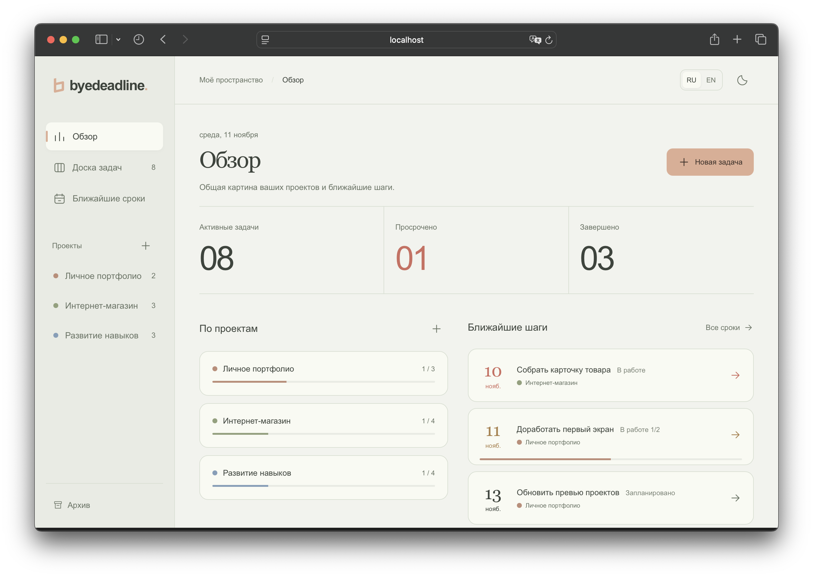
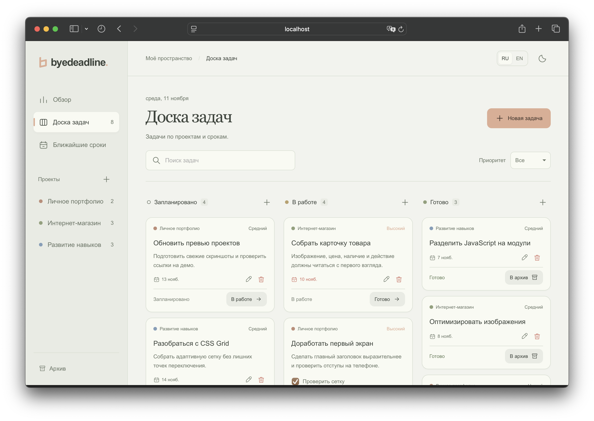
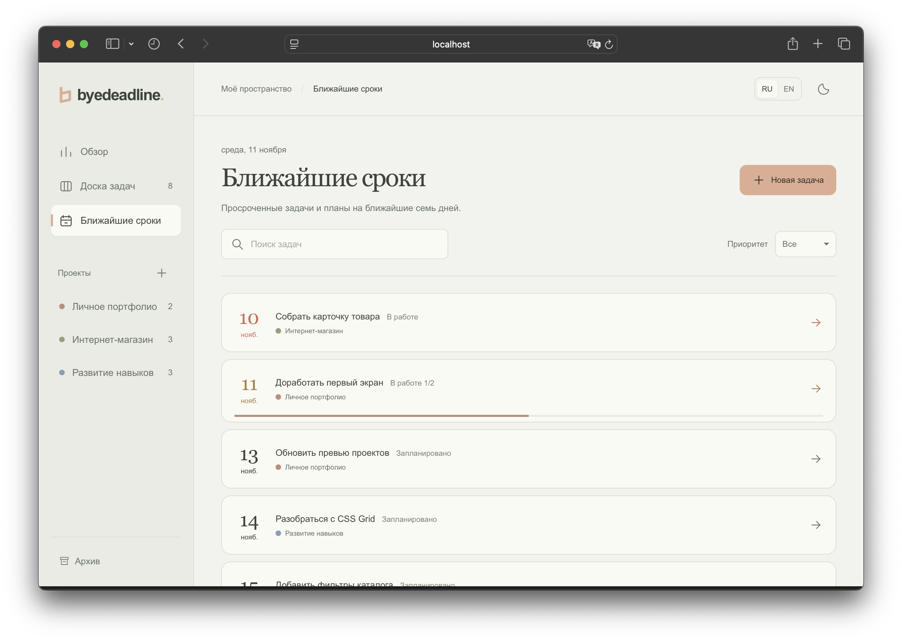
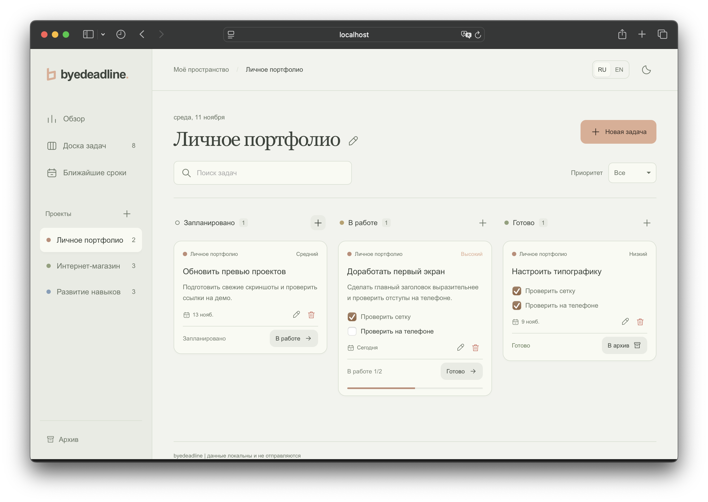
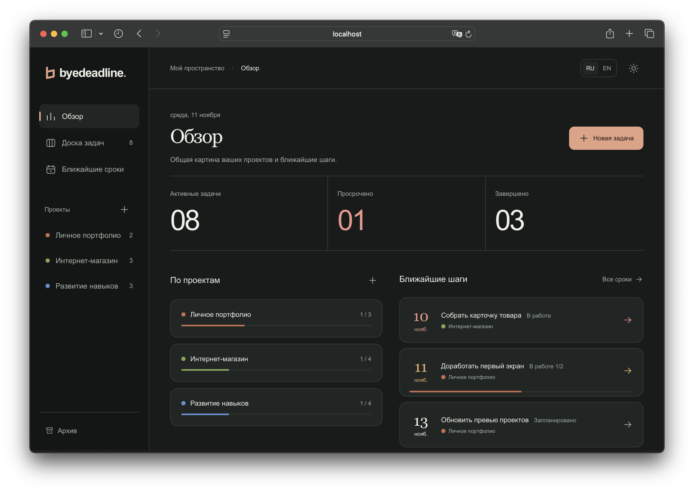
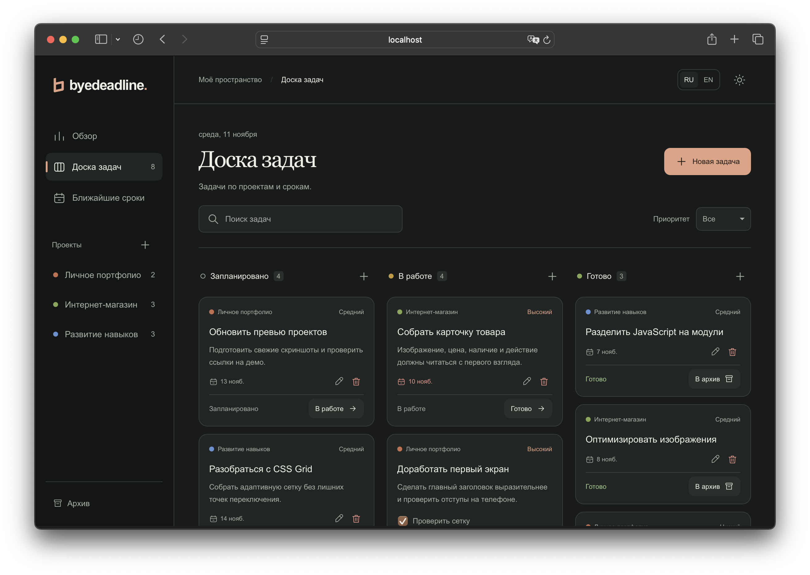
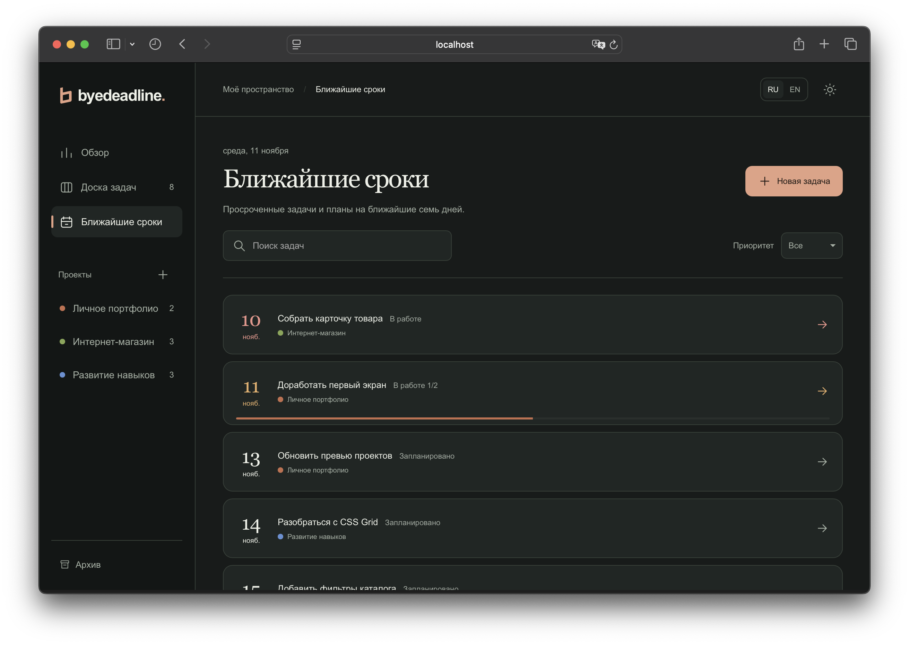
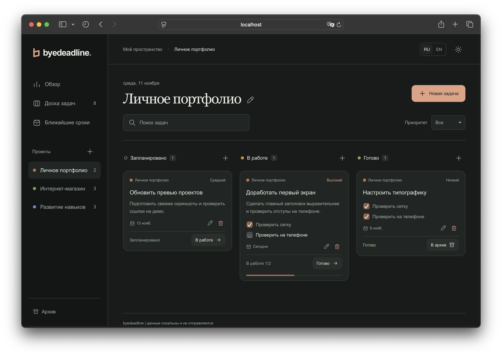

# byedeadline - планировщик задач

Адаптивный планировщик проектов и задач на HTML, CSS и JavaScript.

## Функционал

- Создание, изменение и удаление проектов и задач. Описания проектов, семь цветов и регулируемая ширина боковой панели. Три статуса задач, сроки, приоритеты и чек-листы.
- Отметки чек-листа прямо в карточках и архив завершённых задач с восстановлением.
- Доска с перетаскиванием и кнопками перехода «В работе», «Готово», «В архив».
- Сортировка задач по сроку, задачи без даты отображаются последними.
- Обзор прогресса проектов и список ближайших сроков, включая просроченные задачи.
- Возможность выбора светлой/темной темы и русского/английского языка. Поддержка системной настройки уменьшения движения.

## Данные

Проекты и задачи сохраняются в `localStorage` под ключом `byedeadline-data-v1`. Язык и тема сохраняются отдельно. Все изменения остаются в текущем браузере. Очистка данных сайта удаляет сохранённые задачи. Открытые вкладки на одном адресе обновляются при изменениях в хранилище.

## Превью сайта

### Светлая тема

<table>
  <tr>
    <td></td>
    <td></td>
    <td></td>
    <td></td>
    <td></td>
  </tr>
</table>

### Тёмная тема

<table>
  <tr>
    <td></td>
    <td></td>
    <td></td>
    <td></td>
    <td></td>
  </tr>
</table>